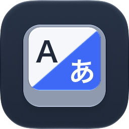
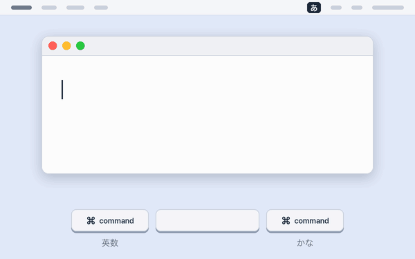
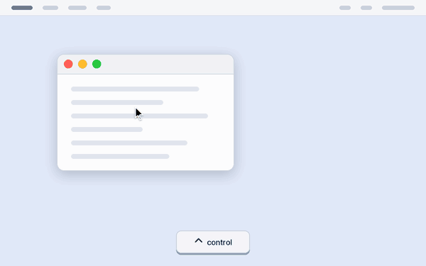
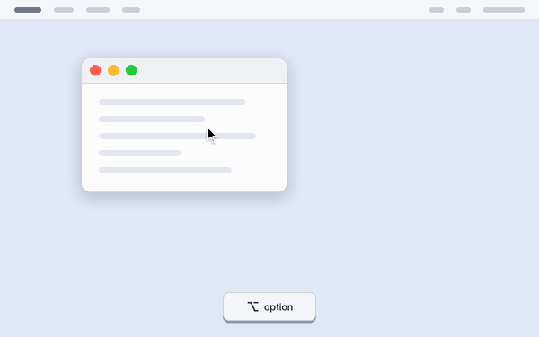
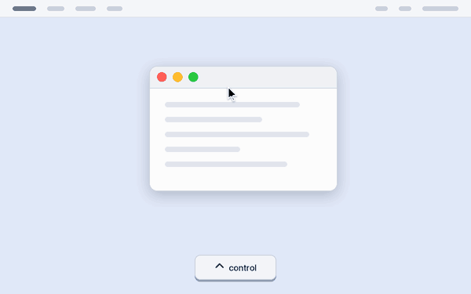

# EisuPlus

⌘キーで英数・かなを切り替え、修飾キーとマウスだけでウィンドウを動かす。メニューバーに常駐する小さな macOS アプリです。

**ダウンロード: https://abeyuya.github.io/EisuPlus/** (macOS 15 以降・Apple の公証済み)

## できること

- **⌘の単押しで英数・かな**: 左⌘で英数、右⌘でかなに切り替える。US 配列でも使える。ショートカットで⌘を使ったときや長押ししたときは切り替えない
- **ウィンドウを移動**: ⌃ を押したままマウスを動かすと、カーソルの下のウィンドウがクリックなしでついてくる
- **ウィンドウをリサイズ**: ⌥ を押したままマウスを動かすと、ウィンドウの右下の角が動く
- **画面の端にスナップ**: 移動中にカーソルを左右の端へ運ぶと画面の半分に、上端へ運ぶと最大化する
- **隣のデスクトップへ運ぶ**: 移動中に左右の端へ押し付けたまま少し待つと、隣のデスクトップへ運ぶ
- **キーの組み合わせは自由**: 修飾キーと操作 (マウス移動・左ドラッグ・右ドラッグ) の組み合わせや、移動やリサイズをしないアプリを設定できる

<table>
  <tr>
    <td><br>⌘の単押しで英数・かな</td>
    <td><br>⌃ + マウス移動でウィンドウを移動</td>
  </tr>
  <tr>
    <td><br>⌥ + マウス移動でリサイズ</td>
    <td><br>画面の端にスナップ</td>
  </tr>
</table>

動きの GIF は `scripts/generate-demo-gifs.py` で描いています。

キー入力とマウス操作を見るために、アクセシビリティの許可が必要です。データは一切収集しません ([プライバシーポリシー](https://abeyuya.github.io/EisuPlus/privacy.html))。

## ソースからビルドする

[XcodeGen](https://github.com/yonaskolb/XcodeGen) で `project.yml` から `EisuMod.xcodeproj` を生成します。

1. `project.yml` の署名のチーム (`DEVELOPMENT_TEAM`) とバンドル ID (`PRODUCT_BUNDLE_IDENTIFIER`) は作者のものなので、自分のものに変える
   - xcodeproj は生成のたびに作り直されるので、Xcode の Signing で変えても次の生成で元に戻る
   - アクセシビリティの許可は署名に結びつくため、ad-hoc 署名だとビルドのたびに許可し直しになる
2. 生成して開く
   ```sh
   brew install xcodegen
   xcodegen generate
   open EisuMod.xcodeproj
   ```

- アプリ名は EisuPlus ですが、ターゲット・スキーム・バンドル ID は旧名の EisuMod のままです
- `scripts/install.sh` は、作者の Developer ID 証明書で署名して `/Applications` に入れるスクリプトです

設計は [docs/PLAN.md](docs/PLAN.md)、リリースと配布の仕組みは [docs/RELEASE.md](docs/RELEASE.md) にあります。

## ライセンス

[MIT License](LICENSE)

自動アップデートに [Sparkle](https://github.com/sparkle-project/Sparkle) を使っています。
